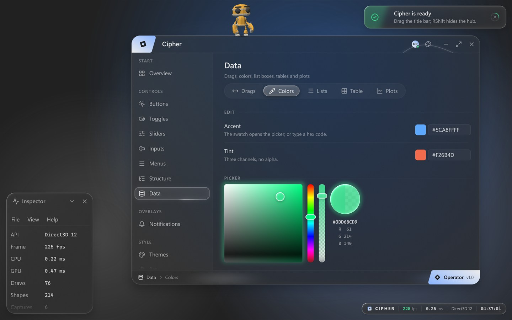
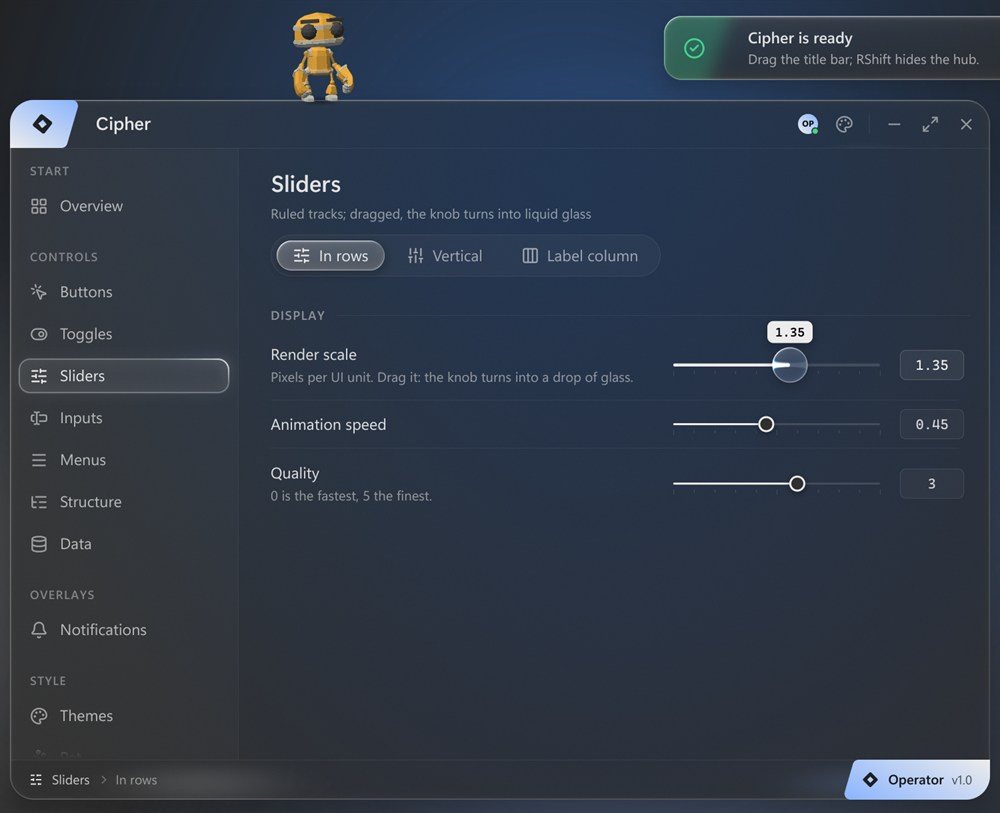
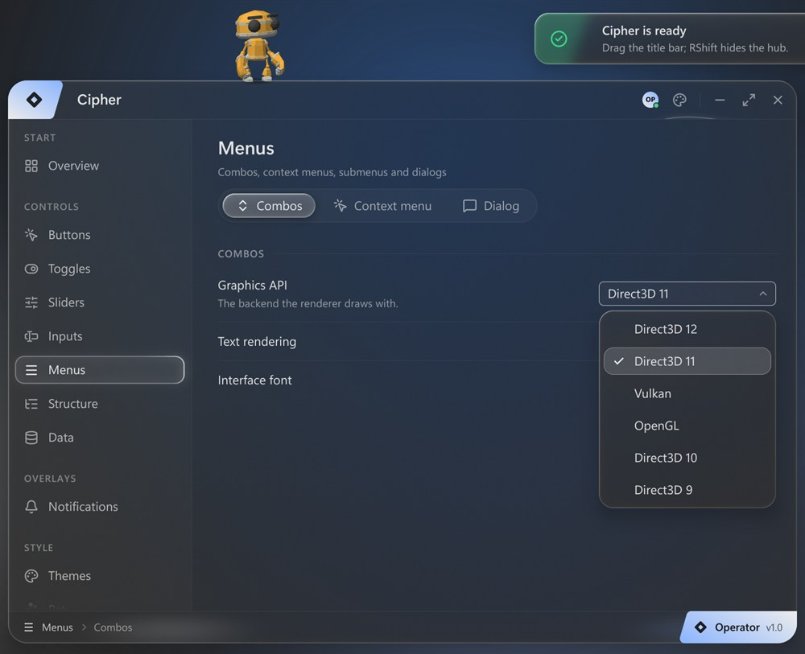
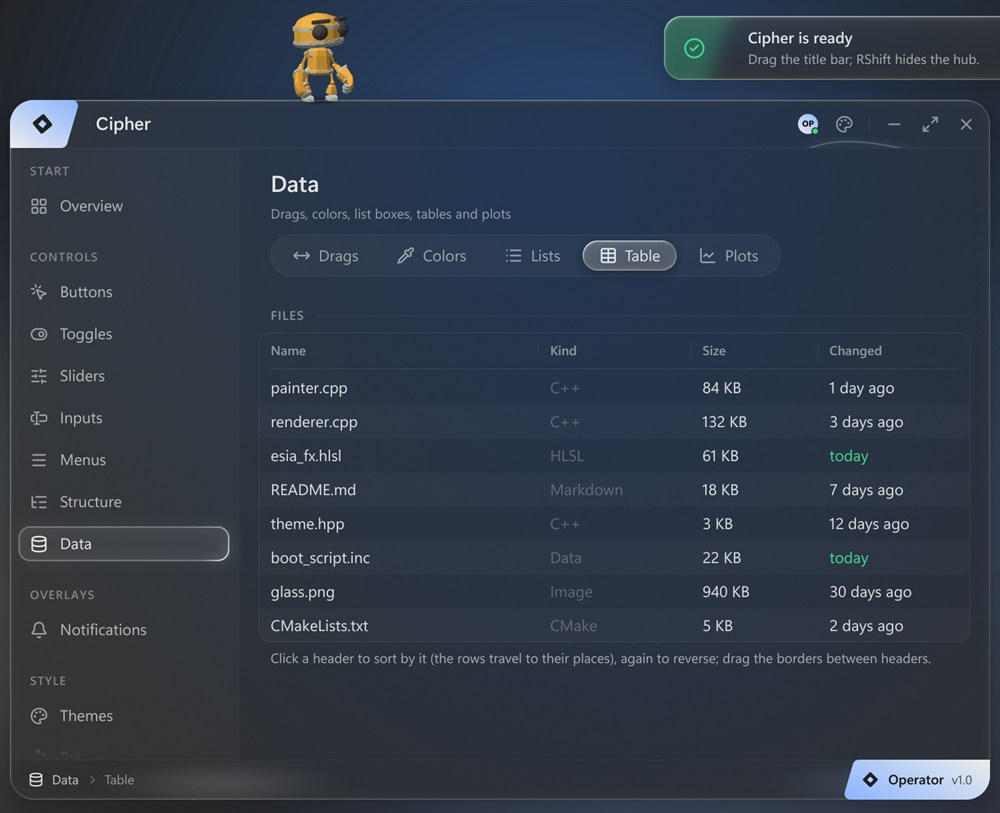
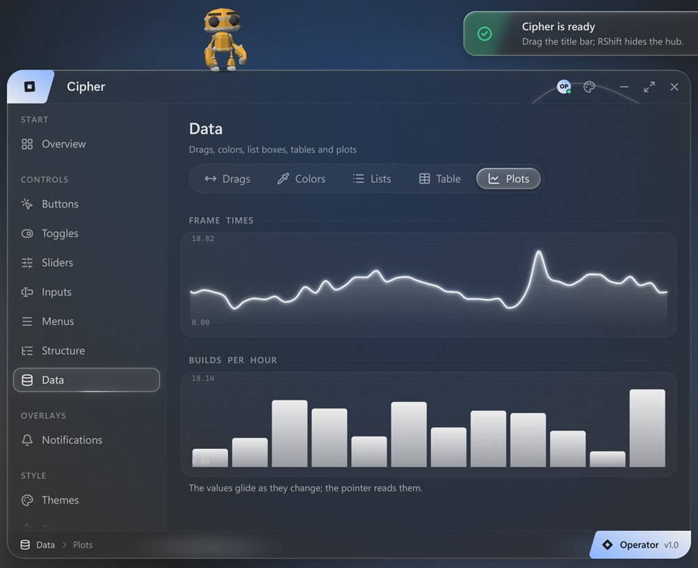
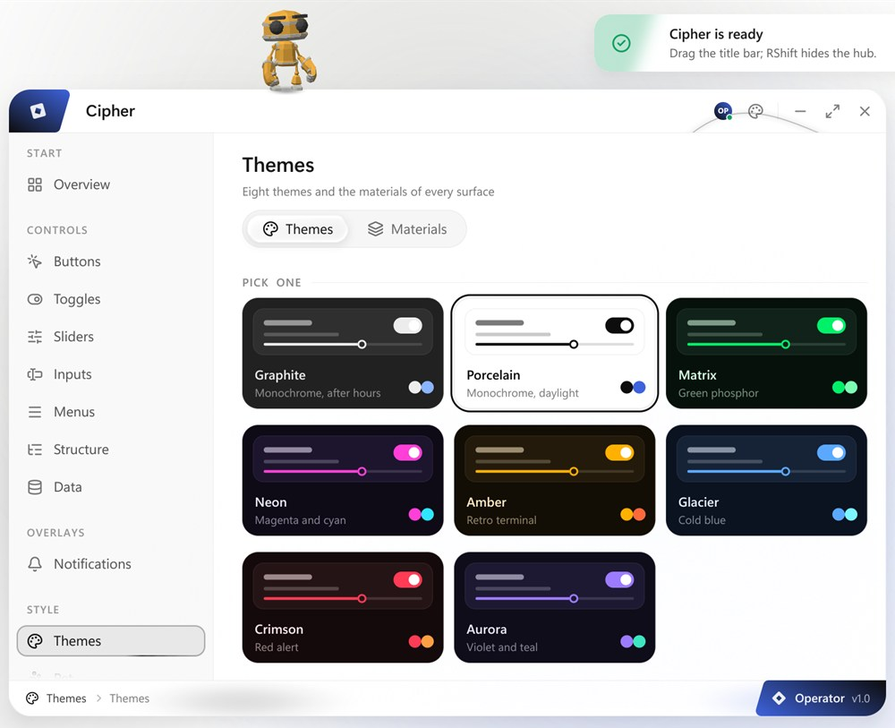
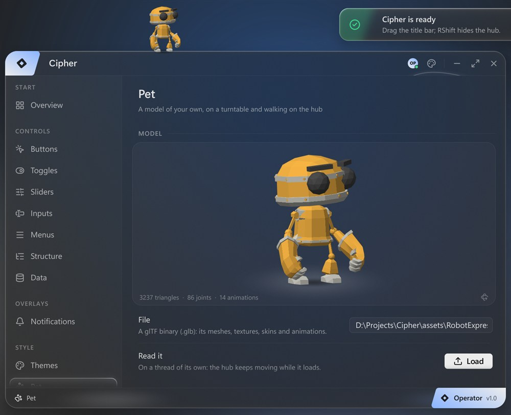
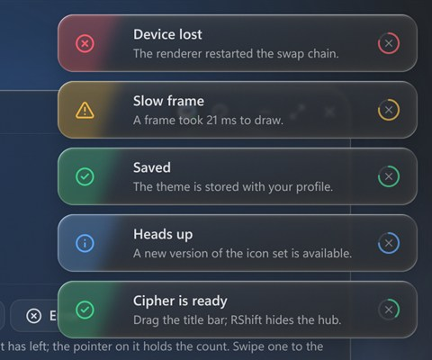
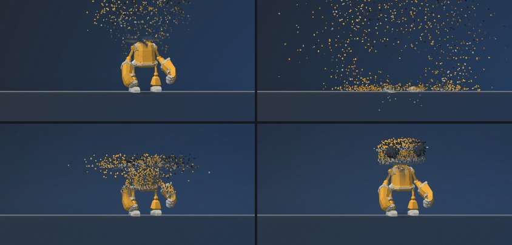
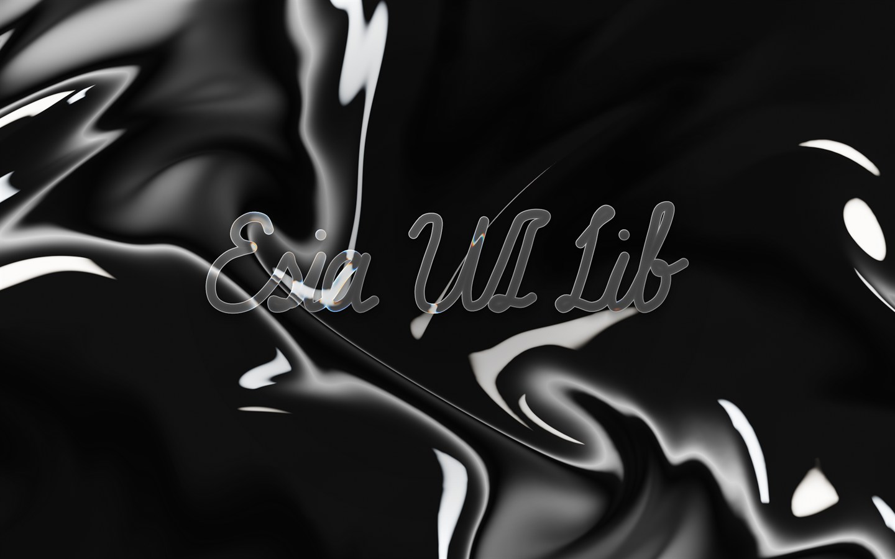

# Esia Cipher UI Lib

A flat, animated immediate-mode UI library for C++, drawn with [Esia](https://github.com/0xDEADBEEFC0DEBABE/Esia)'s
render class (`esia::Painter`) on Esia's core (`esia::Context`). It has Dear ImGui's widget set in a look of its own,
and every change on screen moves on a spring, so any frame can interrupt, reverse or replay it.



## What is in it

- **Every Dear ImGui widget**: buttons, switches, check boxes, radio buttons, selectables, horizontal and vertical
  sliders, drags, text, password, number and multi-line fields, combos, list boxes, menu bars, context menus and
  submenus, modal dialogs, tooltips, collapsing headers, trees, tab bars, tables (sorting, resizable columns, rows that
  glide to their new places), line and bar plots, color edits and pickers. Labels follow Dear ImGui's `##` / `###`
  conventions.
- **Everything animated**, with springs that can be interrupted (`anim.hpp`): hover and press, toggles, folds, tab
  content, numbers that roll their digits, the caret, the selection, typed and deleted characters, and theme changes.
- **A hub window**, with a title bar, a sidebar of tabs in sections, rows of elements and a footer. It moves, resizes
  (a glowing arc in its corner), minimizes into a pill and maximizes. There are also floating windows that drag,
  resize from any edge and collapse.
- **Materials** for every kind of surface: solid, clear glass, liquid glass or frosted glass, with adjustable opacity
  and blur. Text stays legible over any backdrop.
- **Eight themes** that animate into each other color by color.
- **Notifications** that slide in and count down, shown as a ring round the close button. They stack and can be
  swiped away.
- **A watermark** pill showing the frame rate, frame time, graphics API and clock.
- **Vector icons** from [Lucide](https://lucide.dev): all 1,924 of them.
- **An intro**: a full-screen liquid-chrome field. The pointer leaves wakes in it, and a hand-designed cursive title
  is written stroke by stroke in liquid glass.
- **A 3D pet**: a glTF (`.glb`) loader with meshes, textures, skins and animations, drawn with the UI's own
  triangles. The pet walks on the tops of windows, and you can pat, carry and throw it. It can also burst into small
  balls with real physics that the pointer blows around, then rebuild cell by cell.

Every graphics API Esia has: Direct3D 12, 11, 10 and 9, OpenGL and Vulkan.

## Pictures

<p>
  
  
</p>
<p>
  
  
</p>
<p>
  
  
</p>
<p>
  
  
</p>



## Building

You need Windows 10 or 11 and Visual Studio 2022 with the C++ workload. Its CMake and Ninja are used.

- If LLVM is installed (or Visual Studio's clang component), `build.bat` uses clang-cl; otherwise it uses MSVC.
- The Vulkan backend needs the [Vulkan SDK](https://vulkan.lunarg.com). Without it, the other backends are built.

```bat
git clone https://github.com/0xDEADBEEFC0DEBABE/EsiaCipher.git
cd EsiaCipher
build.bat
build\bin\cipher.exe
```

Cipher uses Esia's source tree from `../Esia` when it is there. If it is not, CMake downloads Esia at the commit
Cipher was tested with (`CIPHER_ESIA_TAG`). To use another tree, pass `-DCIPHER_ESIA_DIR=<path>`. The first configure
also downloads FreeType and HarfBuzz for Esia's text system. With plain CMake, run this from a Visual Studio x64
developer prompt:

```bat
cmake -G Ninja -B build -DCMAKE_BUILD_TYPE=Release
cmake --build build --target cipher_demo
```

## The demo

`build\bin\cipher.exe` opens with the intro: click to begin. Right Shift hides and shows the hub. Its options:

| Option | What it does |
| --- | --- |
| `--api d3d12\|d3d11\|d3d10\|d3d9\|opengl\|vulkan` | the graphics API |
| `--size WxH`, `--scale s` | the window's size, the UI scale |
| `--no-boot` | skip the intro |
| `--tab <name>` | open the hub on that tab (`Data`, `Themes`, `Pet` ...) |
| `--backdrop 0\|1\|2` | what lies behind the glass: the theme's, daylight, dusk |
| `--model <file.glb>` | the pet's model |
| `--bench` | print frame, UI and GPU timings |
| `--frames N --screenshot out.png` | save frame N and quit |

To use a model of your own for the pet without the option, name it `assets/pet.glb`. It is git-ignored, and the demo
loads it in place of the robot.

## Using it

```cpp
#include "cipher.hpp"

// once, on Esia's Context and its text system
cipher::Ui ui(ctx, text, cipher::LoadFonts(*text));

// every frame, between Context::NewFrame and Context::EndFrame
ui.NewFrame(pixelScale);   // the display's pixels per UI unit

cipher::HubSpec hub;
hub.title = "Cipher";
hub.version = "v1.0";
if (ui.BeginHub(hub))
{
    ui.HubSection("Settings");
    if (ui.HubTab("Network", cipher::Icon::Wifi, "Connections and sharing"))
    {
        static bool wifi = true;
        ui.Row("Wi-Fi", "Joins the networks it knows.");
        ui.Switch("##wifi", &wifi);
        if (ui.Button("Save", cipher::ButtonKind::Primary))
            ui.Notify({cipher::NoteKind::Success, "Saved", "The settings are stored."});
    }
}
ui.EndHub();

static bool open = true;
if (ui.Begin("Inspector", {.icon = cipher::Icon::Activity, .open = &open}))
    ui.Text("Floating windows drag, resize and collapse.");
ui.End();

ui.EndFrame();   // notifications, the watermark and tooltips, over everything
```

[`demo/main.cpp`](demo/main.cpp) is a complete program. It runs on the frame of Esia's `glass_window` example (window,
swap chain, input), and every tab in it shows one group of widgets. [`cipher/cipher.hpp`](cipher/cipher.hpp) documents
the API.

## The source

| Path | What is there |
| --- | --- |
| `cipher/cipher.hpp` | the API: `Ui`, windows, the hub, widgets, notifications, the watermark |
| `cipher/anim.*` | springs and easing |
| `cipher/theme.*` | the themes and materials |
| `cipher/ui.cpp`, `widgets.cpp`, `inputs.cpp`, `popups.cpp`, `sections.cpp`, `data.cpp`, `hub.cpp` | the widgets |
| `cipher/icons.*`, `lucide_*` | the icons (`lucide_data.cpp` is generated by `tools/gen_lucide.py`) |
| `cipher/boot.*` | the intro (`boot_script.inc` is generated by `tools/script_design.py`) |
| `cipher/model.*`, `pet.cpp` | the glTF loader, the model viewer and the pet |
| `demo/main.cpp` | the demo |
| `assets/RobotExpressive/` | the default pet |

## License

Cipher is MIT-licensed: see [LICENSE](LICENSE). It also includes:

- **Lucide icons**: ISC, © Lucide Icons and Contributors. See [third_party/lucide/LICENSE](third_party/lucide/LICENSE).
- **RobotExpressive**: CC0 1.0. The model is by [Tomás Laulhé (Quaternius)](https://www.patreon.com/quaternius), with
  modifications by [Don McCurdy](https://donmccurdy.com). See
  [assets/RobotExpressive/README.three.md](assets/RobotExpressive/README.three.md).

[Esia](https://github.com/0xDEADBEEFC0DEBABE/Esia) is MIT-licensed. The fonts are the system's (Segoe UI Variable and
Cascadia Mono) and are not bundled.
